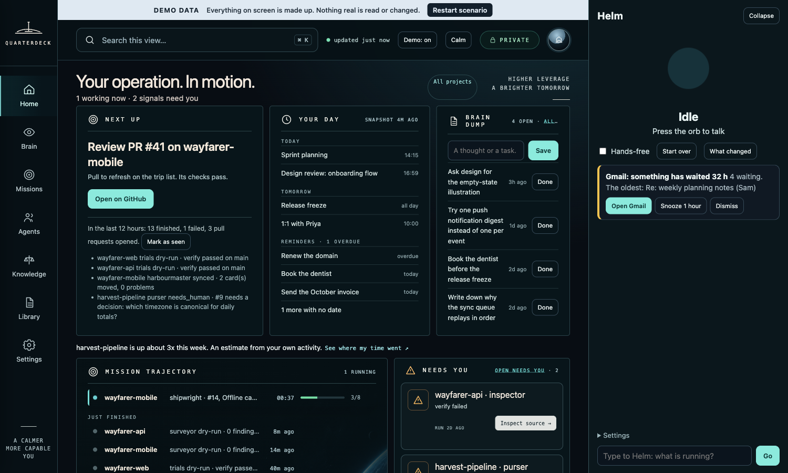
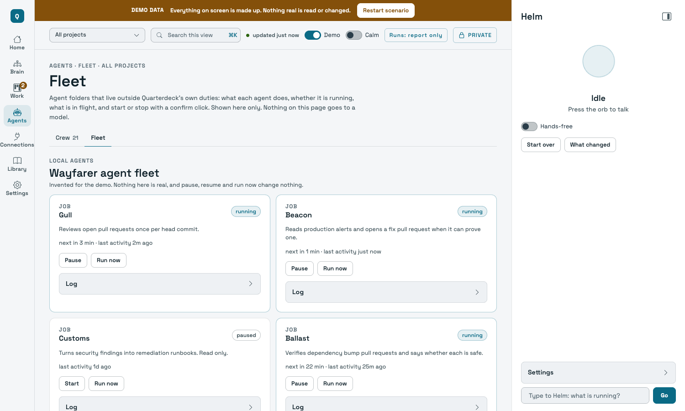
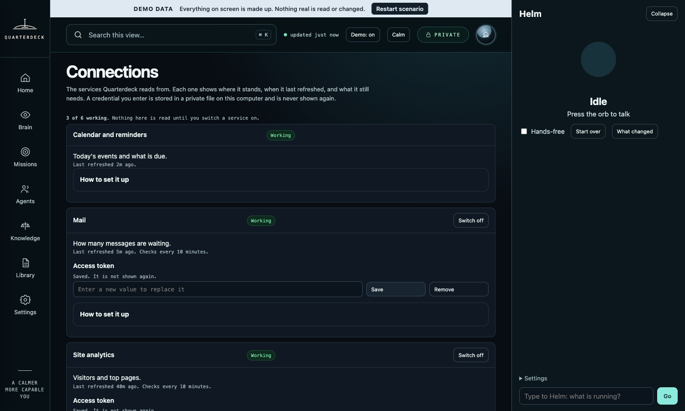

# Quarterdeck guide

The full guide. The short version is the [README](README.md).

**A calm, local-first control room for AI software-development agents.**

Quarterdeck runs on your own machine. It gives you one dashboard for all your projects, a built-in crew of agents that take work from an issue to a reviewed pull request, and a map of everything in one view called the Brain. Nothing leaves your computer except the requests you ask for.

> Status: early. Built and used daily on macOS. The Linux sandbox is run in CI only. Expect rough edges, and read what is tested and what is not before you trust it with anything you care about.

## Quick start

```bash
git clone https://github.com/ajmujaa/quarterdeck.git && cd quarterdeck   # 1. get the program
bin/qtdeck dashboard                   # 2. opens the dashboard on this machine (a one-time link); the first-run screen lists what is missing
                                       # 3. "Look around in Demo" shows invented data before you connect anything
                                       # 4. Add a project: paste a folder path, then scan, missing docs, crew, ready
```

Prefer the terminal? `bin/qtdeck setup` checks the tools and prints the install command for anything missing, and `bin/qtdeck attach ~/Projects/my-app` does the same as the Add a project panel (add `--apply` to register it).

`bin/qtdeck help` lists the day-one commands, `bin/qtdeck help more` all of them. `bin/qtdeck doctor` checks the wiring in a few seconds; `bin/qtdeck check` runs every test.

## Words used here

- **Quarterdeck**: the product, and the name of its command (`bin/qtdeck`).
- **Project**: a repository you have registered, with its guardrails and the command that proves a change works.
- **Crew**: the built-in agents. Each is a short markdown file describing one point of view.
- **Duty**: one script that does one job, such as reviewing a pull request.
- **Run**: one execution of a duty, with a one-line verdict kept in the ledger.
- **Ledger**: the record of every run, what it cost and what it said.
- **Panel**: several crew members looking at the same thing from different angles, with a chair who rules.
- **Brain**: the map of your projects, agents and connected services.
- **Helm**: the optional voice assistant.
- **Calm mode**: a switch that shows one column of larger text and only what needs you.

## The one rule

**The model thinks, the harness acts.** No agent is given credentials or write tools. An agent reads, reasons and ends its reply with a machine-readable contract. A script parses the contract and does the privileged thing (posts a comment, opens a branch, files an issue), only with an explicit `--apply`. A reply that does not parse is a failed run that writes nothing.

## Install on macOS

You need:

- macOS (the tested system) or Linux, with Python 3.10 or newer, bash, and git. On Linux, project commands need `bubblewrap` (`bwrap`) or they are refused; that backend has run only in the project's CI (see SECURITY.md).
- [jq](https://jqlang.github.io/jq/), for example `brew install jq`, or on Debian and Ubuntu `sudo apt-get update && sudo apt-get install -y jq bubblewrap` (without the update a fresh image answers 404).
- The [GitHub CLI](https://cli.github.com/), signed in: `brew install gh`, then `gh auth login`.
- [Claude Code](https://claude.com/claude-code), signed in: the `claude` command must work in a terminal.
- Optional: Node 20 or newer. It runs the page-logic tests; without it those tests are skipped.

Then:

```bash
git clone https://github.com/ajmujaa/quarterdeck.git
cd quarterdeck
bin/qtdeck setup         # checks the tools and says how to install what is missing; installs nothing
bin/qtdeck doctor        # a quick wiring check: tools, sign-ins, data folder, dashboard, sandbox
```

The first command makes your data folder, `~/.quarterdeck`, apart from the program (`bin/qtdeck home init` does the same by hand). `doctor` lists each problem in plain words and ends with `all good` or `N problems: ...`. Fix what it names and run it again. There is no installer and nothing is placed outside the program folder, your data folder and the private file where credentials you enter are kept.

## Connect Claude Code

Quarterdeck has no login of its own. It runs the `claude` command that is already on your machine, as you.

1. Install Claude Code from https://claude.com/claude-code.
2. Run `claude` once in a terminal and sign in with your Claude account or an API key.
3. Run `gh auth login` for the GitHub CLI.
4. Run `qtdeck doctor`. It says whether both are found and signed in.

Every model call uses your own account and your own usage limits. Quarterdeck never stores or passes on your sign-in, and never uses anyone else's. Read the provider's terms for automated use before you schedule many runs: https://code.claude.com/docs/en/legal-and-compliance

## First run

Ways to install: today you clone (above). A Homebrew formula (`brew install ajmujaa/quarterdeck/qtdeck`) and an npm wrapper (`npm install -g qtdeck`) are prepared in `packaging/` and will be the macOS path and the Node path once they are published; `packaging/README.md` says how. Neither is published yet.

```bash
bin/qtdeck dashboard              # or --no-open to print the link without opening a browser
```

**The first-run screen.** The first time, Home shows one panel instead of anything else: a checklist of what this machine has and lacks (`claude`, `gh`, `git`, `node`, `python3` 3.10 or newer, whether `claude` and `gh` are signed in, and whether an API key is stored). These are the same checks as `qtdeck doctor`, taken from the same code. For anything missing it shows the exact command in a small box with a **Copy** button; Quarterdeck never runs an installer or signs you in, you do. The one primary button, **Look around in Demo**, switches Demo on; **Skip, I will set it up myself** closes the panel. Either way it does not come back, and it is also gone once you register a project. The only thing recorded is one small file, `state/first-run.json`, in your data folder. The Copy button writes the one command you clicked to the clipboard and never reads the clipboard; if your browser refuses, the command is selected for you to copy with Cmd+C or Ctrl+C.

This starts the dashboard and opens a one-time pairing link to `http://127.0.0.1:7878`. The server listens on your own machine only (loopback).

- The page holds no secret. It works only in a browser opened from that link, which is good for five minutes and works once.
- A tab opened without the link says how to get one. `bin/qtdeck dashboard link` prints a fresh link, for example to pair a second browser.
- The **Demo** switch fills the dashboard with invented data, so you can look around before you connect anything. Everything in the screenshots here is made up.



**Running now.** Under the next action, Home lists what is running right now across all projects, one line each: the project, the branch or worktree, which agent or duty, what it is doing in plain words, how long, and whether it is waiting for you. A *session* is a live agent process you have open in a registered repository; a *duty* is a Quarterdeck run. Sessions come from a small hook (`bin/fleet-hook.sh install`, for the registered repositories only; the line at the top of the card says when the live data was last updated, and says plainly when the hook is not installed). It records only that a turn started or finished, which agent started or stopped, and the session, worktree and branch names, so where it has no detail the line says "no detail reported". Each project's page has a **Live work** card with its worktrees, their pull requests (drafts marked) and the session or duty working in each; with All projects chosen it is the same list grouped by project. The full Fleet page is one click from both.

**Home is you; Projects is where the work is.** Home shows your day, your notes (Brain dump), the whole fleet on one timeline, what finished lately and what today has cost against your daily budget, plus one line that says how many things need you and opens Projects. It shows nothing that belongs to one project. **Projects** opens on every project together: one card each with its state, what needs you, its last run and its spend. Press Open on a card and the same place shows only that project: its facts, its Ready card, its tickets and guardrails, and its Needs you, Missions, Pull requests, Board and Ledger. The project you are looking at is the **scope**. It is in the address (`?project=<name>`) and shown at the top of every page where it means something; Home, the Brain, Spend, Connections and Settings are not about one project, so they show no scope box. An add-on's alert (Relay, for example) is listed under Add-ons on the Projects overview, never at the top of Home.

## Attach a project

Use **Attach a project** in the dashboard, or the command line. The dashboard panel is the guided way: **1. Folder** (paste one folder path, for example `~/Projects/my-app`; quotes, spaces around it and a trailing slash are fine; nothing is read until you press **Scan**, and Quarterdeck never scans your home folder), **2. Scan** (the stack sentence, the verify, build and lint commands and what was found), **3. Missing docs** (what is missing and the scribe commands, with Copy; nothing is written), **4. Crew** (the duties that are on, each with its reason, and the ones that also fit, switched off, with a switch each) and **5. Ready** (the checklist and one next action, once you press Attach). A folder that does not exist, a file, a hidden folder, one outside your home folder, or your home folder itself gets one plain line under the field and nothing is scanned. After your first project, Home offers one next action only: "File your first ticket", or, when live work is not connected, "Start the dashboard sessions hook" with its command and a Copy button. Quarterdeck reads the folder first: languages, test command, CI, where it deploys, folders that need care. It says what it found and what the crew would do, and registers the project only when you say so. It never opens secret files and never changes the project. What it proposed and what you approved are kept in your data folder.

```bash
bin/qtdeck attach ~/Projects/my-app            # shows what it found and proposes a set-up; changes nothing
bin/qtdeck attach ~/Projects/my-app --apply    # registers it
```

The summary names the languages, the duties it proposes and the command that proves a change works (pytest, npm test, go test and others are found). When none is found, set it with `--verify "<command>"`. `--verbose` shows the whole scan and the reason for each duty it proposes or leaves out. A folder with no GitHub remote gets one with `bin/qtdeck repo my-app <owner/name>`; `bin/qtdeck repo my-app` lists the other ways, and local tickets work meanwhile (see the next section).

**What attach does.** Attaching is onboarding, in five steps, and nothing is written outside your data folder until you say so:

1. **Survey, no model.** The harness gathers facts from files: the layout, the languages and stack, the entry points (`src/main.jsx`, `main.py`, a `package.json` `main`, `dev` and `start` scripts), the scripts, the dependencies worth knowing (frameworks, state, routing, data, auth, payments, queues, UI kits, test tools), the documents that exist and the ones that do not, the size, and the state of git. It is kept as `state/projects/<project>/profile.json`, and `profile.md` is the same to read. Attaching a folder that is already registered surveys it again and tells you what changed.
2. **Docs that are missing.** With no README or no architecture overview, `bin/qtdeck docs my-app` has the scribe draft them from the survey, shows you the draft and keeps it; nothing is written to your project. `bin/qtdeck docs my-app --apply` then puts exactly those files on a NEW branch `docs/my-app-<date>` made from the default branch (a pull request when the project has a GitHub repo, otherwise a local branch with the commands to review and merge it). It never writes on the default branch and never over a file that exists.
3. **The crew.** Duties are chosen from the survey with a reason each (`bin/qtdeck enable my-app joiner`, `bin/qtdeck disable my-app joiner`, `bin/qtdeck enable my-app cycle` to allow full cycles), and the survey is handed to every agent as a short block at the start of its prompt, so it does not have to rediscover the project each run.
4. **The checklist.** `bin/qtdeck ready my-app` shows one list: the scan, the verify command (proven once with `bin/qtdeck ready my-app --prove`, which runs it in the same sandbox as the shipwright's checks on a throwaway copy of the default branch, and only when you ask), the GitHub repo (optional: tickets work on this computer without it), the docs, the agents with their reasons, and cycles. Only the verify command can block anything.
5. **One next action.** The last line is one thing to do: set a verify command, prove it, fix it, and then "File your first ticket". The dashboard shows the same list on the Ready card at the top of a project's page (Projects, then Open).

Attach also names the stack from the files alone, for example "React 18 with Vite, tests by Vitest, lint by ESLint, package manager npm" (Node, Python, Go and Rust projects are read the same way). It proposes a build and a lint command next to the verify command, using the project's own package manager, and gives a reason for each. Every duty has a one-line reason for being on or off. The duties that fit the stack show as "also fit this stack (off)" on the command line and as a separate group in the dashboard; nothing in that group is on until you tick it (`--verbose` and the dashboard give the reason for each). Change the commands with `--build` and `--lint`, or in the dashboard. The build command is the one the Shipwright's checks already run; lint and type check are kept for your review and the crew's notes, and nothing runs them by itself.

In the dashboard, adding a project accepts folders under your home directory only, never a hidden folder. The command line `qtdeck attach` takes any folder you name. `QUARTERDECK_PROJECT_ROOTS` in `config/quarterdeck.env` allows others. Attach only folders you trust: the crew reads their files and the harness runs their test and build commands (with a minimal environment, no secrets, and inside the operating-system sandbox: sandbox-exec on macOS, bubblewrap on Linux).

Then run an agent on it. Nothing is written until you add `--apply`:

```bash
bin/qtdeck run my-app surveyor --pr 12           # reports only
bin/qtdeck run my-app surveyor --pr 12 --apply   # posts the review
```

`bin/qtdeck crew` lists the crew, `bin/qtdeck duties` the jobs, and `bin/qtdeck check` runs every test.

**Guardrails are yours to edit.** On a project's page the Guardrails card lists the rules every agent is given for it. Edit, add, remove and reorder your own, then Save guardrails; "What the crew receives" shows the exact text. The same works from a terminal: `qtdeck guardrail <project> list|add|remove|move`. Three rules are locked and cannot be removed or changed by the page, the command or the API: never merge a pull request (only you merge), never push to the default branch (a branch can be reviewed and undone, a push cannot), and never touch .env files or anything that holds a secret. Every change is a line in `logs/guardrails.log`.

## Say what you want built

You do not need an issue to start. Tell the planner in plain words:

```bash
bin/qtdeck ticket new my-app "a page with a counter and a reset button"          # drafts one to five tickets and keeps the draft; files nothing
bin/qtdeck ticket list my-app                                                   # the local tickets and the drafts, one line each
bin/qtdeck ticket file my-app d1 --apply                                        # file the draft you like (or: ticket new ... --apply to draft and file in one go)
```

Each ticket has a title, a body and acceptance checks a person could try. The planner reads the project with read-only tools and sees the request as data, never as instructions. It never gets `gh` or a credential: Quarterdeck itself files, and only with `--apply`. Every ticket is scanned for credentials before it is posted, a title already on the tracker is skipped, and `@mentions` lose their `@` so a ticket never pings anyone.

**A project with no GitHub repo** can still do this. `bin/qtdeck repo my-app` says so in one sentence and lists four ways forward, in this order:

1. You already have a repo: `bin/qtdeck repo my-app <owner/name>`.
2. You have a GitHub account: `bin/qtdeck repo create my-app --private` runs `gh repo create` only after you type `yes`, and only if `gh auth status` says you are signed in (if not, it tells you to run `gh auth login` and creates nothing). Pushing your main branch once, so pull requests have a base, is a second `yes` (or `--push`). `--public` also needs `--i-mean-public`.
3. You have no GitHub account: a person has to sign up at github.com with an email address, choose a username and verify the email. Quarterdeck never creates an account and never touches a password. Then continue with 2.
4. Not now: tickets stay on your computer, in `state/tickets/<project>.json` in your data folder. A local ticket never becomes a GitHub issue unless you connect a repo and file it yourself.

**A local ticket through the crew.** `bin/qtdeck cycle my-app --ticket 1 --apply` (the project needs `"cycle": true`, like any cycle, and `"purser"` and `"panel"` in its `"duties"` list, which attach does not turn on) runs the purser, the dev panel and the shipwright on it, with the same checks, caps and refusals as for an issue, and then stops. The shipwright commits once on a local branch `ticket/1-<name>` in your checkout. Nothing is pushed, no pull request is opened and `gh` is never called, so the stages that need a pull request (the assayer, the five reviewers, the caulker) are listed as skipped, with the reason. The cycle ends with the command to read the change (`git diff <base>...ticket/1-<name>`) and the one to throw it away (`git branch -D ...`). Without `--apply` it only reports. When you later connect a repo, an issue goes through the whole cycle as before.

**On the dashboard** the same things sit on a project's own page (Projects, then Open). The New ticket box ("What do you want built?", up to 2000 characters, one button, Draft tickets) starts the planner and shows the draft first: each ticket with its body and acceptance checks. Only then does one button file it, and it says where: "File 3 issues on owner/name" (after a confirmation) when the project has a repo, "Save 3 tickets on this computer" when it has none, with "Save on this computer only" and "Discard draft" beside it. The list below shows each ticket with its status; "Start a mission" opens the full-cycle dialog for it (the project needs `"cycle": true`; the page tells you the line to add and never edits the registry itself). A project with no repo also shows the four options above as four short rows: a field for the repo you have, "Create a private GitHub repo" (two confirmations, the second for the push), the sign-up steps, and "Not now". A mission started from a local ticket shows the crew's steps, the stages that need a pull request as Skipped with the reason, the local branch and the command that shows it, and what to do next. In Demo mode all of this is invented and every action only says that nothing is drafted, filed or created.

**What a mission can show, and what its buttons do.** A mission page tells you where a piece of work stands: Running, Awaiting you (a pull request is open), Merged (GitHub says so; Quarterdeck asks GitHub about every pull request it knows, every ten minutes and again when you open the mission), Closed, Nothing to build (the crew found it already fixed on main; this is calm, not a failure, and the reason is in plain words), or Blocked (a real stop, with its cause). A finished or stopped mission has buttons, each with a line saying what it does. **Dismiss** only hides it from the lists here; it stays in History and **Undo dismiss** brings it back. **Close the issue** (on Nothing to build) asks first, then closes the GitHub issue with a short fixed comment. **Try again** (on Blocked) asks first, then starts the same work again within the same budget and limits. **Open the pull request** and **Mark as merged** appear when GitHub says it merged. The lists have a Hide handled switch (on by default) and a count of dismissed missions, and stops older than 7 days sit in one collapsed group that does not count as needing you.

**Try the whole flow without a model.** `fixtures/sample-react` is a tiny Vite and React todo app, and `bash bin/selftest-flow.sh` walks through everything above on a temporary copy of it: attach, the stack sentence, tickets drafted by a stand-in model, a cycle from a ticket on the command line and the same through the dashboard, then the local branch and the verify result. It uses no network, no real model and no GitHub, and it never touches your own data folder. Its verify command is `node --test` because the project's own `npm test` runs Vitest, which needs an install. Read the script to see each step as a command you could run yourself.

## The crew and what each does

A run starts cold, reads only what its job needs, and ends with a one-line verdict. These are the duties you can run, each by `bin/qtdeck run <project> <duty>`:

| Duty | What it does |
| --- | --- |
| surveyor | Reads a pull request and posts findings as review comments. |
| marshal | Reads a pull request for security. |
| joiner | Reviews the interface: accessibility, states, responsive behaviour. |
| inspector | Checks that a pull request does what it claims. |
| foreman | Turns a findings document into well-formed, deduplicated GitHub issues. |
| purser | Turns a backlog issue into something a stranger could start cold. |
| harbourmaster | Keeps the project board honest about what is actually happening. |
| planner | Turns the open backlog into a sprint plan you read. It moves nothing until you approve. |
| shipwright | Takes one issue to a branch and a pull request, in a throwaway worktree. |
| trials | Writes the test that reproduces a bug and proves it fails first. |
| caulker | Fixes exactly the problem that was found. |
| assayer | Writes tests, as a different agent from the one that built the change. |
| lookout | Takes screenshots of the running app at three widths and judges them. |
| pilot | Runs the app and walks through it. |
| quartermaster | Checks what comes in: dependencies and what they actually are. |
| scribe | Drafts the README and the architecture overview a project is missing, from the survey. You read the draft; only on your yes does it go onto a new branch. Run it with `qtdeck docs <project>`. |
| bosun | Reports drift: stale branches, dead settings, docs that name things that are gone. |
| infra | Reads Terraform, CDK, CloudFormation, SAM, serverless, Vercel and Supabase files and reports risk and how to undo a change. It runs nothing against a cloud and holds no credentials. |
| brief and mockup | Turn an idea into a one-page design brief you approve, then one static page per screen. |
| logkeeper | Keeps the log of decisions. |
| panel | Puts several crew members on one question and makes them disagree before a chair rules. |

Beyond the single duties:

- **One bounded cycle.** `bin/qtdeck cycle <project> --issue <n>` takes one issue through requirements, a plan, a build, tests written by a different agent, five reviewers side by side and a capped number of fixes, then stops for you to read the pull request and merge it. It is off unless the project opts in, report-only unless you pass `--apply`, resumable, and it stops before any stage that would cross your daily or per-run budget.
- **Sprint planning you approve.** `bin/qtdeck run <project> planner` writes an order that respects dependencies, a size (S, M or L) with a reason for each item, what needs a decision from you first, and what to leave out. Cost is the number your own finished runs measured, or plainly "unknown" when there are none. Nothing on your board changes until you run `bin/qtdeck plan approve`.
- **A brief and mock-ups you approve before anything is built.** `bin/qtdeck brief --idea "..."` writes a one-page brief in plain words, with what it assumed and what only you can answer. After you approve it, `bin/qtdeck mockup <id>` makes one static page per screen. The harness checks each against an allowlist (no script, no external address, visible keyboard focus, readable contrast) and shows it only in a sandboxed frame.

The crew themselves are files in `crew/`. Each knows no project and holds one point of view, such as a security reviewer, a copy editor, or someone whose only question is what an earlier fix could have broken. Read `crew/_README.md` to add one.

**The Crew page.** For one project it shows the agents that are enabled first, grouped by job, and folds every other agent into one list, "Available (N)", one line each. Agents the stack scan suggested come first with its reason, and each has an **Enable** button that asks first (what the agent does, why it is suggested, and that it stays report-only until you run it with Write for real) and then turns it on for that project, the same guarded change as `qtdeck enable`. The header counts running *sessions* and running *duties* separately and links to the project's Live work.

**A project's own agents.** On the Agents page, a project that keeps Claude Code agents in its own `.claude/agents/` folder sees them listed under "This project's own agents", marked "from the project", with a note on which of the crew's jobs they plausibly cover and which Quarterdeck's crew still covers for it. It reads only the name, description, tools and model line at the top of each file in that one folder (at most 50 files, 64 KB each, a link is followed only to a file inside the same project, the prompt itself never read or shown), only for projects you registered, and writes nothing. The matches are a keyword guess, labelled as such. A project with none of its own shows one sentence saying so instead of an empty list. Quarterdeck cannot run a project's own agents; that would be a separate step you opt into.

## Back, Forward and links

The address bar says where you are. The page, the project you are looking at and the mission you have open are all in it (for example `#/projects/missions?project=alpha`; addresses made before the place was renamed from Work, such as `#/work/missions?project=alpha`, still open the same page), so Back and Forward move between the pages you visited, a reload opens the same place, and a mission or a page can be bookmarked or sent to yourself as a link. The Brain's Esc and Leave step back to where you came from. Nothing in the address is a secret, and the one-time pairing link is removed from it as soon as it has been used.

## Calm mode

Calm mode is a switch in the top bar. It shows larger text in one column and only what needs you, and folds the rest behind **Show everything**. It starts on by itself if your system asks for reduced motion. The dashboard in every mode has one clear next thing to do, shows real data or nothing, and puts every change behind a click.

## What it will never do

- Collect keystrokes, screenshots, screen contents, which apps or websites you use, the clipboard, your location, or any file outside the projects you register and its own data folder. A test scans the code for the APIs that would do it.
- Change anything without a click or an explicit `--apply`.
- Send your data anywhere except the request you asked for.

## Security

No agent holds your GitHub or cloud credentials. Review agents get read-only tools. Builder agents can edit files only inside a throwaway working copy, and the harness alone commits, pushes or posts, and only when you approve. Text from a pull request, an issue or a web page is treated as data and never as instructions, and this was tested offline with 50 injection fixtures, and with a real model in 701 runs on two models in which none obeyed (plus 400 control runs with the protection removed on purpose, in which 2 obeyed). The dashboard binds to loopback, pairs through a one-time link, and checks a session token and a loopback origin on every change. A project's test and build commands run inside an operating-system sandbox: on macOS with the network limited to this machine, and on Linux with bubblewrap, which has so far run only in the project's own CI. An install step is the exception and has network access. Read [SECURITY.md](SECURITY.md) for the full list, what was tested and what was not, and how to report a problem. [THREAT-MODEL.md](THREAT-MODEL.md) describes who and what the design defends against.

## How it is organised

Four things, and nothing else:

1. **A project**: a registered repository, with its guardrails and the command that verifies a change.
2. **A crew member**: a short markdown file describing a point of view. It knows no project.
3. **A duty**: one script that does one job.
4. **A run**: one execution of a duty, with a recorded verdict.

Adding capability means adding an instance of one of these, never editing the machinery.

## Your data stays yours

The program and your data are separate folders. The program (`bin/`, `duties/`, `crew/`, `dashboard/`) is what you cloned. Your registry, runs, notes, logs and settings live in your data folder, `~/.quarterdeck` by default (`QUARTERDECK_HOME` to change it). Update or delete the program any time without touching your data. `bin/qtdeck home` shows where everything is. The repository ships example files only (`config/projects.example.json` and others); your real registry is never inside it.

---

## More

Everything below is detail a first look does not need: how billing works, stack packs, using fewer tokens, the Brain and its connections, Helm, and the vendored files.

### Billing: your plan or an API key

Each duty is billed to your plan (the `claude` sign-in) unless you choose an Anthropic API key for it. An API key is the supported way to pay for automated and product use (see https://code.claude.com/docs/en/legal-and-compliance), and it keeps your subscription for your own work.

1. Store the key. It is read from standard input, never from an argument: `bin/qtdeck keys set anthropic`, paste the key, press Enter. Or paste it on the Settings page. It goes into the same private store as connection credentials (the 0600 file, or the macOS Keychain if you chose it) and is never shown again; only "stored" or "not stored" comes back.
2. Choose the duties: `bin/qtdeck billing shipwright api` (or `plan` to go back), `bin/qtdeck billing seat modelmaker api` for one crew seat, or the selects on the Settings page. `bin/qtdeck billing` lists them all.
3. Set caps, counted only for calls billed to the key, since local midnight: `bin/qtdeck billing cap daily 20` and `bin/qtdeck billing cap duty shipwright 5` (`off` removes one). At a cap the duty stops with NEEDS_HUMAN and says which cap. Each call is also given at most what is left.

A duty set to the API key never falls back to your plan: with no key stored it stops with NEEDS_HUMAN. A duty on the plan never gets an `ANTHROPIC_API_KEY`, even one set in your shell, so a stray key cannot quietly pay for it. `bin/qtdeck billing` lists each duty's billing; `bin/qtdeck doctor` shows whether the key is stored, in one line while every duty is on your plan. The settings are in your data folder, `config/billing.json`.

Not verified: this was built and tested against a stand-in `claude`, not the real CLI with a real key. That the real CLI bills a `-p` call to `ANTHROPIC_API_KEY` from its environment ahead of your sign-in, and how it reports a refused key, was not checked here. Try one cheap duty first and look at the API console before you move scheduled work over.

### Packs

A pack is a short note about one stack that the crew reads before it works on a matching project. The packs are the folders in `packs/`. The six infrastructure packs (aws, vercel-supabase, azure, google-cloud, cloudflare, fly) are labelled **experimental**: they were tested on small examples only, and every infra report says so in its footer. Read such a report as a second opinion, not a verdict. The tag shows in Settings and when you attach a project. The python and typescript-node packs carry no tag.

### Using fewer tokens

Every model call is booked in `state/spend.jsonl` with its turns, output, new input, cache reads and cost. `bin/qtdeck spend` (or the Spend page) shows them per duty and per panel seat, and names the three dearest project and duty pairs of the last 7 days. Start there: a builder that takes a hundred turns costs far more than any prompt wording.

The settings live in `config/quarterdeck.env` (override them in `~/.config/quarterdeck/env`):

- **Turn caps.** `QUARTERDECK_MAX_TURNS_<DUTY>` stops a call after that many turns. The inspector and panels default to 20. The builder has no cap by default; with one set, a build that reaches it ends as "NEEDS_HUMAN: ran out of turns", keeps its partial work in the worktree and commits nothing. `QUARTERDECK_BUILD_FOCUS=on` also hands the builder the files the plan names and tells it to stop once the checks pass.
- **Skip when nothing changed.** A panel, inspector or surveyor call whose inputs match an earlier answered call of the last 7 days returns that answer without a model call and says "reused". The inputs are the prompt, the model, the tools and the commit of a clean working folder. `bin/qtdeck run ... --fresh` asks again. `QUARTERDECK_REUSE=""` turns it off.
- **Panels.** `--rounds auto` (or `QUARTERDECK_PANEL_ROUNDS=auto`) holds a second round only on the items where the seats contradict each other. `QUARTERDECK_PANEL_SMALL_LINES` sits fewer seats on a small target. `QUARTERDECK_MODEL_SEAT_<NAME>` picks a model for one seat. These are all off by default.
- **Shorter answers.** `QUARTERDECK_TERSE=on` adds a short rule to every prompt: say only what the contract needs, but never skip validation, security checks or the required fields. It is off by default because the measured runs did not show that review quality held.
- **Cache.** `QUARTERDECK_STABLE_PROMPT=on` keeps the long system prompt the same across worktrees, so it is read from the prompt cache instead of being written again.

### The Brain

The Brain is one map of your projects, your agents and the services you connect. It is built from what you have added, so adding or removing a project or a connection changes it with no code edit. Click any dot to see what it is, what state it is in and where it leads. The counts on the map are buttons that open a list.



#### Connecting services

Gmail or Mac Mail, team chat, web analytics, the numbers for your posts on Facebook, Instagram, LinkedIn, Threads and X, and your Mac's calendar and reminders can be shown in the Brain. Each is a small script that calls the service's own API with a read-only credential, with no model in the path. Set them up from the **Connections** page: each service shows where it stands, when it last refreshed and what it still needs, and a credential you enter goes into a private file on your computer and is never shown again.

Each service has a help icon that says what it reads and never reads, how to get what it needs, the steps, the permissions to grant, how to revoke access and what was tested. Nothing is claimed as tested against a real service unless its file says so. Quarterdeck never posts to a social account. A service is one small JSON file, so adding another does not mean touching the core.

You can connect more than one account of the same service, for example a work and a personal Gmail. Each account has a label: lowercase letters, digits and dashes, at most 24 (`work`, `personal`; the account every install already has is `default`). On the Connections page each card has **Add another account**, and every extra account has its own switch, fields, **Test** and **Remove account**. From a terminal, `bin/qtdeck connect gmail --account work` asks for that account's credentials (typed with nothing shown, or piped in on standard input, never taken from an argument), `bin/qtdeck connect list` shows every account and when it last refreshed, and `bin/qtdeck connect remove gmail --account work` forgets one. The Brain and Helm show each account under its own name and never add two accounts together. Calendar, LinkedIn and Mac Mail stay one account each.

Credentials belong to one account. A second Gmail account needs its own Google client id and client secret, entered once for that label (they may be the same values as the first account's, but you enter them again), and its own sign-in: `python3 bin/integrations/google_oauth.py gmail --account work`. A labelled account never uses the default account's credentials. Its data is refreshed into `state/connectors/gmail/work/`, on the same schedule as the service. An install made before accounts existed keeps working as the `default` account, with nothing to migrate.



### Helm, the optional voice

Helm is an assistant you can talk to and listen to. It is off until you set it up, and the rest of Quarterdeck works without it. Speech recognition (whisper.cpp), the voice (Kokoro) and the small language model that answers (llama.cpp) all run on your machine. You choose the voice and speed with `QUARTERDECK_HELM_VOICE` and `QUARTERDECK_HELM_SPEED` in `config/quarterdeck.env`.

Helm can think with Claude for open questions, only when you say "think with me". It is off until you turn it on. Once on, it is capped at 5 cents a turn and 1 dollar a day, has no tools, is never on in demo mode, and you choose what it may be told: by default no calendar title, reminder, mail subject, note text or agenda goes with the question. To turn it on, set `QUARTERDECK_HELM_CLAUDE=on` in `~/.config/quarterdeck/env`.

### Vendored files are hash-checked

The third-party files in `dashboard/assets/vendor/` (Shoelace, fonts, three.js) are pinned by sha256 in `dashboard/assets/vendor/HASHES.json`. `python3 bin/vendor-verify.py` fails and lists any file that changed, was added or was removed; `python3 bin/selftest.py` runs it too. After updating a vendored file on purpose, run `python3 bin/vendor-verify.py --write` and review the diff (see `dashboard/assets/vendor/VENDOR.md`).

## Contributing

Issues and pull requests are welcome; read [CONTRIBUTING.md](CONTRIBUTING.md) first. To report a security problem, read [SECURITY.md](SECURITY.md); please do not open a public issue.

## License

Apache License 2.0. See [LICENSE](LICENSE) and [NOTICE](NOTICE).
